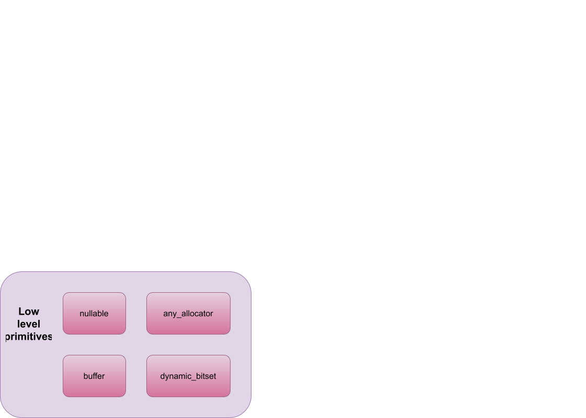
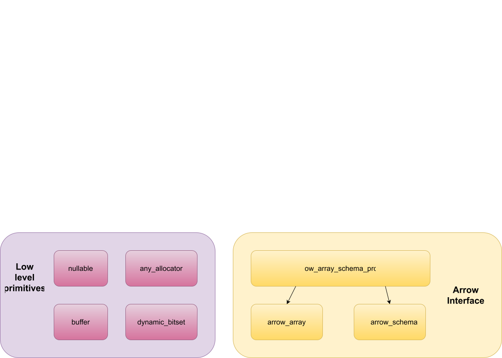
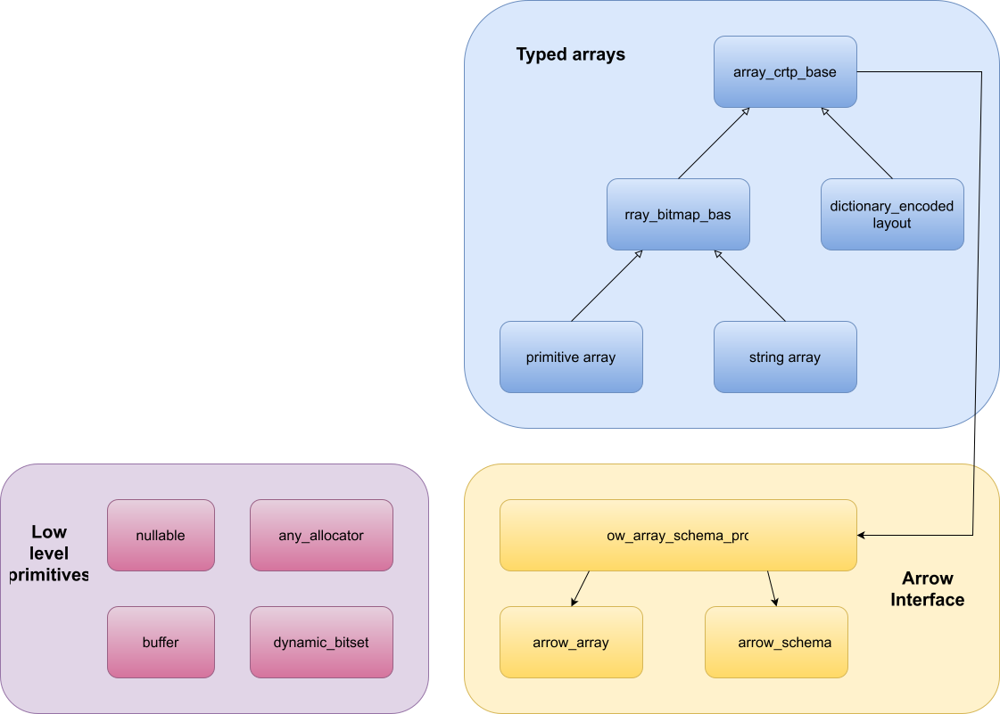
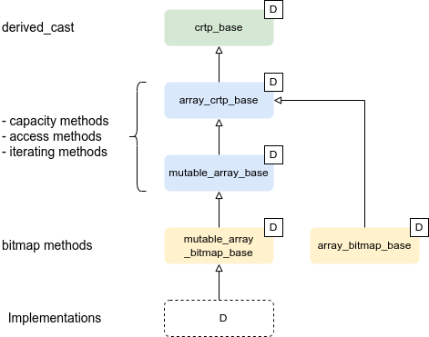
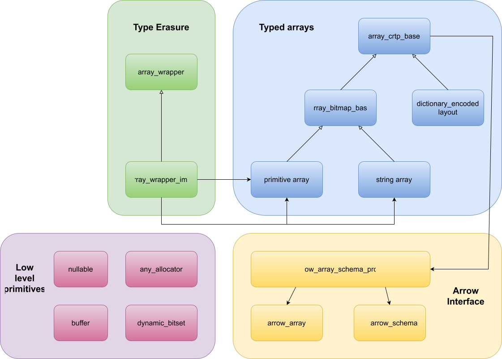
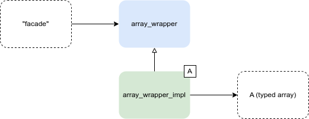
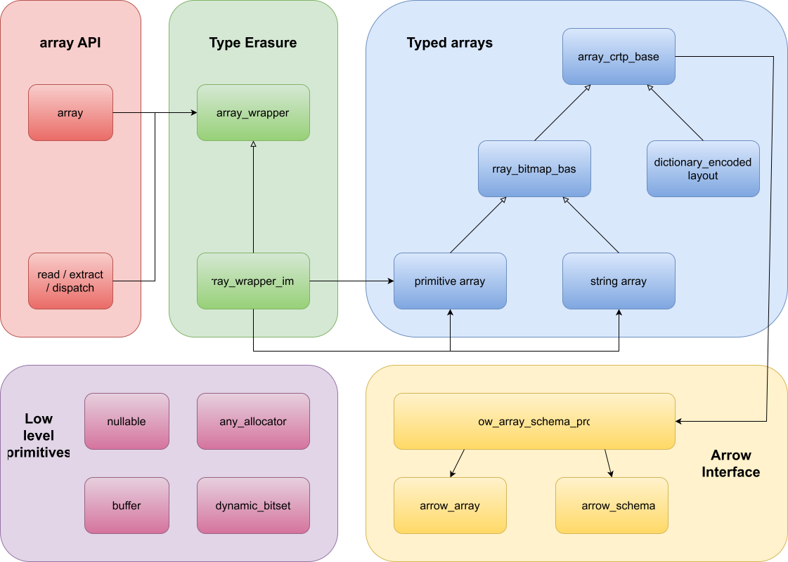

<style>
section::after {
  content: attr(data-marpit-pagination) '/' attr(data-marpit-pagination-total);
}
</style>


<h1>The Sparrow ecosystem: Arrow in modern minimal C++20</h1>
<h2>OpenTeams meetup - October 2026</h2>
<h4>Johan Mabille</h4>
<br>
<br>


---
# About

<table class="invisible-table">
    <tr>
        <td>
            
            <strong>Johan Mabille</strong><br>
            Technical Director at QuantStack<br>
            Contributor to Jupyter, mamba, xtensor
        </td>
    </tr>
</table>

---

# Why Sparrow ?

* Apache Arrow's tabular format has become the industry standard
* Apache Arrow is a huge monorepo with many dependencies, while some projects only need the memory format implementation (e.g., ArcticDB)
* Apache Arrow started more than 10 years ago, and C++20 brought new features that we can leverage in a fresh, modern project

---

# What are Sparrow libraries ?

Idiomatic C++20 implementations of the Apache Arrow memory format + canonical extensions, IPC and PyCapsule featuring
* value semantics, ranges, and iterators ...
* Support for both typed and untyped arrays
* Mutability for typed arrays
* Convenient constructors and builders for easy usage
* Built-in std::formatters for all Sparrow types

---

# Sparrow properties

* Zero dependencies for Sparrow
  * ... except when compiling with libc++ (P0355R7 Timezone)
  * ... zstd and lz4 if support for compressed IPC
* Passes all Apache Arrow integration tests, compatible with formats 1.0 to 1.5
* Packaged for Conda, Conan, Fedora and vcpkg
* Licensed under Apache License v2 or BSD

---

# Apache Arrow memory format: recap

**Core ideas**

* Columnar, language-agnostic in-memory layout
* Zero-copy sharing via the C Data Interface (`ArrowSchema` + `ArrowArray`)
* Array = length, null count, buffers, children, optional dictionary
* Record batch = schema + equal-length columns
* Buffers 8-byte aligned (64 recommended) and padded
* Validity bitmap, can be omitted when there are no nulls

---

# Apache Arrow memory format: recap

**Fixed-size primitive layout**

```
[1, null, 2, 4, 8]
```

```
* Length: 5, Null count: 1
* Validity bitmap buffer:

  | Byte 0 (validity bitmap) | Bytes 1-63            |
  |--------------------------|-----------------------|
  | 00011101                 | 0 (padding)           |

* Value Buffer:

  | Bytes 0-3   | Bytes 4-7   | Bytes 8-11  | Bytes 12-15 | Bytes 16-19 | Bytes 20-63           |
  |-------------|-------------|-------------|-------------|-------------|-----------------------|
  | 1           | unspecified | 2           | 4           | 8           | unspecified (padding) |
```

---

# Apache Arrow memory format: recap

**Variable-size binary layout**

```
['joe', null, null, 'mark']
```

```
* Length: 4, Null count: 2
* Validity bitmap buffer:

  | Byte 0 (validity bitmap) | Bytes 1-63            |
  |--------------------------|-----------------------|
  | 00001001                 | 0 (padding)           |

* Offsets buffer:

  | Bytes 0-19     | Bytes 20-63           |
  |----------------|-----------------------|
  | 0, 3, 3, 3, 7  | unspecified (padding) |

 * Value buffer:

  | Bytes 0-6      | Bytes 7-63            |
  |----------------|-----------------------|
  | joemark        | unspecified (padding) |
```

---

# Architecture

---



---

# Low level primitives:

* nullable: represents null values, API similar to std::optional
* dynamic_bitset: "Compressed" buffer of boolean
* buffer: std::vector-like, able to take ownership of C-allocated arrays
* any_allocator: type erasure for allocators

---



---

# Arrow interface:

* Proxy classes over ArrowArray and ArrowSchema
* Can have ownership of ArrowArray and ArrowSchema

---



---

# Typed arrays

* One array class per layout (more than 10 layouts + variations)
* 2 kinds of layouts: nested and non-nested
* All arrays provide almost the same API

---

# Typed arrays



---

# Typed arrays

```c++
template <class D>
constexpr auto array_crtp_base<D>::operator[](size_type i) const -> const_reference
{
    auto& derived_cast = this->derived_cast();
    SPARROW_ASSERT_TRUE(i < derived_cast.size());
    return const_reference(inner_const_reference(derived_cast.value(i)), derived_cast.has_value(i));
}
```

---



---

# Type erasure



---



---

# Untyped array

```c++
sp::array ar(std::move(array), std::move(schema));
std::cout << "name: "               << ar.name().value()  << std::endl;
std::cout << "size: "               << ar.size()          << std::endl;
std::cout << "front: "              << ar.front() << std::endl;
std::cout << "back: "               << ar.back()  << std::endl;
std::cout << "ar[4].has_value(): "  << ar[4].has_value()  << std::endl;
```

---

# Record batch

* two-dimensional dataset composed of:
  * contiguous arrays, each the same length
  * a schema which must match its arrays' datatypes

---

# Sparrow IPC
```c++
const std::vector<sp::record_batch>& batches = /* ... */;
std::vector<uint8_t> stream_data;
sp_ipc::memory_output_stream stream(stream_data);
sp_ipc::serializer serializer(stream);
serializer << batches << sp_ipc::end_stream;
return stream_data;
```

```c++
std::vector<sp::record_batch> batches = sp_ipc::deserialize_stream(stream_data);
```

---

# Sparrow Rockfinch

## Exporting to python

```c++
PyObject* sparrow_array = sp::pycapsule::create_sparrow_array_object(std::move(my_array));
```

```python
from polars._plr import PySeries
ps = PySeries.from_arrow_c_array(sparrow_array)
```

---

## Exporting to C++

```python
import pyarrow as pa
arrow_array = pa.array([1, 2, None, 4, 5])
sparrow_array = SparrowArray(arrow_array)
```
or 
``` c++
// Receive capsules from Python (e.g., from __arrow_c_array__)
PyObject* schema_capsule = /* ... */;
PyObject* array_capsule = /* ... */;
// Import into sparrow array
sp::array imported_array = sp::pycapsule::import_array_from_capsules(
        schema_capsule, array_capsule);
```

---

# Sparrow Compute

```c++
#include <sparrow-compute.hpp>

sparrow::primitive_array<double> a{1.0, 2.0, 3.0};
sparrow::primitive_array<double> b{4.0, 5.0, 6.0};
auto result = sparrow::compute::eval(sparrow::compute::sqrt((a + b) / 2.0));
```

---

# What's Next

* Sparrow tables
* Computation kernels
* GeoArrow

---

# Contributors

<table class="invisible-table" style="table-layout: fixed">
  <tr>
    <td style="text-align: center; width: 200px;">
      
      <strong>Alexis Placet</strong><br>
      @Alex-PLACET
    </td>
    <td style="text-align: center; width: 200px;">
      
      <strong>Johan Mabille</strong><br>
      @JohanMabille
    </td>
    <td style="text-align: center; width: 200px;">
      
      <strong>Thorsten Beier</strong><br>
      @DerThorsten
    </td>
  </tr>
  <tr>
    <td style="text-align: center; width: 200px;">
      
      <strong>Joël Lamotte</strong><br>
      @Klaim
    </td>
    <td style="text-align: center; width: 200px;">
      
      <strong>Julien Jerphanion</strong><br>
      @jjerphan
    </td>
    <td style="text-align: center; width: 200px;">
      
      <strong>Hind Montassif</strong><br>
      @Hind-M
    </td>
  </tr>
</table>

---

# Thanks !

# Resources

- Apache Arrow specification: https://arrow.apache.org/docs/format/Columnar.html
- Github repositories:
  - sparrow: https://github.com/sparrow-org/sparrow
  - sparrow-ipc: https://github.com/sparrow-org/sparrow-ipc
  - sparrow-rockfinch: https://github.com/sparrow-org/sparrow-rockfinch
  - sparrow-compute: https://github.com/sparrow-org/sparrow-compute
- Documentation: https://sparrow-org.github.io/sparrow/index.html
